# AtmoPraxis

> **Neuro-Symbolic Urban Air Quality Co-Pilot & Spatiotemporal Exposure Mitigation Framework for Winter Smog Navigation, DIY Air Purification Physics, and Low-Emission Community Routines**

[]()
[](LICENSE)
[]()
[]()
[]()
[]()

---

## 1. Abstract & Executive Summary

Severe winter smog in dense metropolitan airsheds presents an acute public health hazard. Conventional air quality tracking applications function as passive informational monitors, displaying raw Air Quality Index (AQI) values without providing actionable, physically grounded mitigation guidance. Furthermore, naive foundation models deployed as conversational health assistants frequently suffer from arithmetic drift and physical hallucinations—often recommending outdoor morning aerobic exercise during severe nocturnal thermal trapping layers or failing to account for aerosol filtration fluid mechanics.

**AtmoPraxis** resolves this limitation by introducing a **Neuro-Symbolic Urban Air Quality Framework**. It couples:
1. A **Deterministic Biophysical Governor**: Executes closed-form mathematical equations for multi-standard AQI conversions (US EPA & Indian NAQI), atmospheric planetary boundary layer (PBL) thermal inversion trapping dynamics, Corsi-Rosenthal box fan Clean Air Delivery Rate (CADR) fluid mechanics, and human minute ventilation ($V_E$) inhalation micro-dosimetry.
2. A **Generative Neural Co-Pilot**: Powered by Google Gemini (with an autonomous offline deterministic fallback) to synthesize spatiotemporally synchronized daily routines, indoor bio-shielding protocols, and personalized sustainable habit alternatives tailored to specific household personas (Families with Children, Commuters, Vulnerable Groups, and Active Athletes).

---

## 2. System Architecture

```mermaid
flowchart TD
    subgraph Inputs["1. Tropospheric & User Context Inputs"]
        A["Global City & Coordinates<br/>(Open-Meteo Geocoding / GPS)"]
        B["Real-Time Air Speciation<br/>(PM2.5, PM10, NO2, SO2, CO, O3)"]
        C["Meteorological Soundings<br/>(Temp 2m, Wind Speed, Relative Humidity)"]
        D["User Persona & Mobility Profile<br/>(Family, Commuter, Athlete, Transit Mode)"]
    end

    subgraph SymbolicCore["2. Deterministic Biophysical Governor (Symbolic Core)"]
        E["Multi-Standard AQI Solver<br/>US EPA & Indian NAQI Breakpoints"]
        F["Thermal Inversion & Boundary Layer Engine<br/>Mixing Height H_mix & Trapping Risk Index"]
        G["Corsi-Rosenthal DIY Purifier CADR Solver<br/>Air Changes / Hour (ACH) & Exponential Decay"]
        H["Human Respiratory Micro-Dosimetry Engine<br/>Minute Ventilation V_E & Berkeley Cigarette Model"]
        I["Emission Abatement & Carbon Model<br/>Tailpipe PM2.5 & CO2e Avoidance Accounting"]
    end

    subgraph NeuralLayer["3. Generative Neural Co-Pilot (Neural Synthesis)"]
        J["Personalized Routine Synthesizer<br/>Commute Window Shifting & Smog Peak Avoidance"]
        K["Indoor Air Quality Bio-Hacker<br/>Midday Solar Ventilation & Particulate Sinks"]
        L["Direct Impact & Physiological Explainer<br/>Alveolar Barrier & Vascular Stress Translation"]
        M["Dual-Inference Transport<br/>Google Gemini 2.5 Flash + Zero-Cloud Offline Fallback"]
    end

    subgraph UI["4. Accessible Client Experience (WCAG 2.1 AA)"]
        N["Real-Time Speciation & Smog HUD"]
        O["Interactive 24-Hour Inversion Timeline"]
        P["Interactive Corsi-Rosenthal Purifier Studio"]
        Q["Sustainable Lifestyle Habit Simulator"]
        R["Clean Air Daily Dossier (Print/PDF & .ICS Export)"]
    end

    Inputs --> SymbolicCore
    Inputs --> NeuralLayer
    SymbolicCore <--> NeuralLayer
    SymbolicCore & NeuralLayer --> UI

    classDef core fill:#042f2e,stroke:#14b8a6,stroke-width:2px,color:#fff;
    classDef neural fill:#1e1b4b,stroke:#818cf8,stroke-width:2px,color:#fff;
    classDef ui fill:#0f172a,stroke:#38bdf8,stroke-width:2px,color:#fff;
    class SymbolicCore core;
    class NeuralLayer neural;
    class UI ui;
```



---

## 3. Mathematical & Theoretical Formulations

### 3.1 Multi-Standard AQI Piecewise Interpolation
Both the United States Environmental Protection Agency (US EPA) and Central Pollution Control Board (India NAQI) standards evaluate index value $I_p$ for pollutant concentration $C_p$ via linear interpolation:

$$I_p = \frac{I_{Hi} - I_{Lo}}{BP_{Hi} - BP_{Lo}} (C_p - BP_{Lo}) + I_{Lo}$$

Where:
- $BP_{Hi}, BP_{Lo}$ represent the concentration breakpoints enclosing $C_p$.
- $I_{Hi}, I_{Lo}$ represent the corresponding index category breakpoints.
- The overall composite index is governed by:

$$I = \max_{p \in \mathcal{P}} \{ I_p \}$$

### 3.2 Planetary Boundary Layer (PBL) & Thermal Inversion Trapping
During winter nights, radiative ground cooling induces a positive lapse rate ($\frac{dT}{dz} > 0$), capping vertical convection. The Inversion Trapping Index ($I_{trap}$) and Ventilation Coefficient ($VC$) are formulated as:

$$VC = H_{mix} \times u_{10}$$

$$I_{trap} = \min \left( 100, \left(1 - \frac{H_{mix}}{800}\right) \times 50 + \left(1 - \frac{u_{10}}{20}\right) \times 35 + \left(\frac{RH}{100}\right) \times 15 \right)$$

When $VC < 2,000 \text{ m}^2\text{/s}$ and $H_{mix} < 200 \text{ m}$, stagnant air traps particulate emissions directly at breathing height.

### 3.3 Corsi-Rosenthal DIY Box Fan Fluid Dynamics & Particulate Clearance
The effective Clean Air Delivery Rate ($CADR_{eff}$) across a multi-filter plenum is governed by:

$$CADR_{eff} = Q_{fan} \times \eta_{filter} \times \phi_{plenum} \times \psi_{speed} \times \omega_{carbon}$$

Air Changes per Hour (ACH) and clearance decay follow first-order differential decay:

$$ACH = \frac{CADR_{eff} \times 60}{V_{room}}$$

$$C(t) = C_0 \cdot e^{-ACH \cdot t} \implies t_{1/2} = \frac{\ln(2)}{ACH} \times 60 \text{ minutes}$$

$$t_{90} = \frac{2.3026}{ACH} \times 60 \text{ minutes}, \quad t_{99} = \frac{4.6052}{ACH} \times 60 \text{ minutes}$$

### 3.4 Inhalation Micro-Dosimetry & Berkeley Earth Equivalence
Total inhaled particulate mass depends on physiological minute ventilation ($V_E$):

$$\text{Dose}_{\mu g} = \sum_{k} \left[ C_{PM2.5}(k) \times V_E(\text{activity}_k) \times \Delta t_k \right]$$

Equivalent daily cigarettes smoked ($\mathcal{E}_{cigs}$) is derived from the empirical threshold where $22\text{ }\mu g\text{/m}^3$ 24-hour chronic exposure equates to approximately 1 cigarette:

$$\mathcal{E}_{cigs} = \frac{\text{Dose}_{\mu g}}{237.6\text{ }\mu g}$$

---

## 4. Key Functional Modules

| Module | Purpose | Biophysical / AI Method |
| :--- | :--- | :--- |
| **Real-Time Speciation HUD** | Global air quality monitoring across PM2.5, PM10, NO2, SO2, CO, and Ozone. | Open-Meteo Air Quality & Geocoding API integration (zero API keys required). |
| **Thermal Inversion Monitor** | 24-hour boundary layer mixing height and smog lock visualization. | Atmospheric lapse rate modeling and ventilation coefficient solver. |
| **Low-Emission Routine Studio** | Personalized daily routine optimizer for families, commuters, athletes, and vulnerable groups. | Google Gemini 2.5 Flash structured synthesis with deterministic offline fallback. |
| **Corsi-Rosenthal Studio** | Interactive DIY box fan purifier CADR, ACH, and particulate clearance calculator. | Fluid dynamic plenum solver and exponential decay modeling. |
| **Sustainable Habits Engine** | Micro-mobility and heating alternatives with quantified tailpipe PM and CO2e savings. | Empirical emissions inventory and neighborhood collective impact multiplier. |
| **Direct Health Translator** | Converts abstract ambient readings into deep alveolar deposition and equivalent cigarette metrics. | Berkeley Earth dose-response formulation. |
| **Clean Air Daily Dossier** | Printable daily operational summary and `.ics` iCalendar schedule export. | Standardized RFC 5545 iCalendar serialization and print CSS styling. |

---

## 5. Technology Stack & Design Principles

- **Frontend & Runtimes**: React 18, TypeScript 5.7 (strict mode), Vite 6.
- **Styling & UX**: Tailwind CSS, Lucide React icons, dark/light contrast-optimized palettes.
- **Testing**: Vitest 2.1 (100% test pass rate across mathematical and symbolic engines).
- **Accessibility**: Full WCAG 2.1 AA/AAA compliance with semantic HTML5 elements, ARIA live regions for dynamic atmospheric updates, and full keyboard navigation.
- **Security & Efficiency**: Zero external secret requirements; optional Gemini key stored solely in ephemeral browser session storage; client-side edge computing (< 5ms solver execution time); production bundle under 300 KB (< 80 KB gzip).

---

## 6. Quick Start & Installation

### Prerequisites
- Node.js >= 18.x
- npm >= 9.x

### Setup Commands

```bash
# Clone the repository
git clone https://github.com/Arpanthebaap/AtmoPraxis.git
cd AtmoPraxis

# Install dependencies
npm install

# Start development server
npm run dev
```

### Running Automated Test Suites

```bash
# Execute Vitest test suites
npm test

# Run TypeScript strict type verification
npm run typecheck

# Build optimized production bundle
npm run build
```

---

## 7. Verification & Benchmark Results

The deterministic symbolic algorithms and biophysical equations of AtmoPraxis have been verified with automated unit tests:

```text
 ✓ src/test/inhalation_dosage.test.ts (1 test)
 ✓ src/test/emission_abatement.test.ts (1 test)
 ✓ src/test/aqi_calculator.test.ts (3 tests)
 ✓ src/test/corsi_rosenthal.test.ts (3 tests)
 ✓ src/test/thermal_inversion.test.ts (2 tests)

 Test Files  5 passed (5)
      Tests  10 passed (10)
   Duration  < 600 ms
```

---

## 8. License

This project is licensed under the **MIT License**. See [LICENSE](LICENSE) for details.
